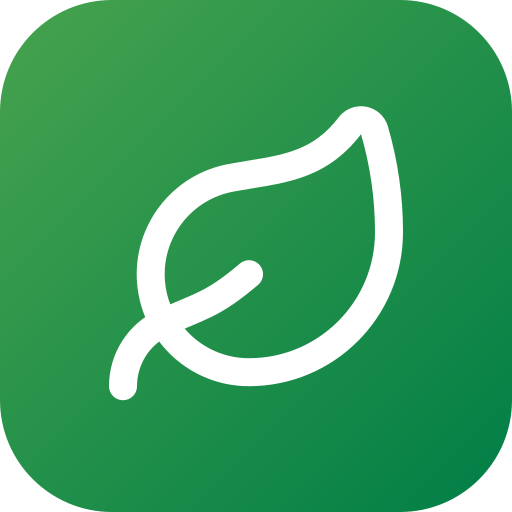
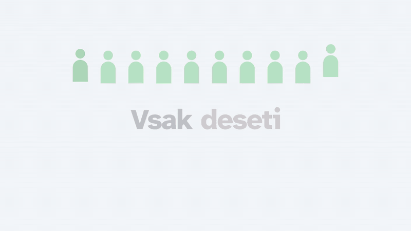

<p align="center"></p>

<h1 align="center">zDoma</h1>

<p align="center">Spremljanje pacientov doma po odpustu iz bolnišnice: pacient in svojci rešijo, kar lahko, sestra vidi samo tisto, kar ostane, vedno z razlogom.</p>

<p align="center"><b>Spletna stran:</b> <a href="https://zdoma.tian-istenic34.workers.dev/">zdoma.tian-istenic34.workers.dev</a></p>

<p align="center"><b>Za ocenjevalce:</b> <a href="docs/PREGLED.md">pregled vseh funkcionalnosti (docs/PREGLED.md)</a></p>

<p align="center"><a href="./LICENSE"></a>    <a href="https://zdoma.tian-istenic34.workers.dev/"></a></p>

<p align="center"><a href="https://cdn.jsdelivr.net/gh/Lukajekul/zDoma@main/docs/media/zdoma.mp4"></a><br><sub>▶ <a href="https://cdn.jsdelivr.net/gh/Lukajekul/zDoma@main/docs/media/zdoma.mp4">Video z zvokom (MP4)</a></sub></p>

Projekt za ADAHack 2026, izziv 1: *Spremljanje pacientov na domu po odpustu iz bolnišnice.*

Po odpustu gre pacient domov skoraj brez nadzora. Zapleti, kot so poslabšanje srčnega popuščanja ali napake pri zdravilih, pogosto ostanejo neopaženi, dokler se pacient ne vrne na urgenco. zDoma opazi, česar pacient sam ne sporoči: zdravila, ki jih ni prevzel v lekarni, izpuščene tablete, težo, ki počasi narašča. Najprej opomni pacienta in svojce, šele nato osebje. Dnevni pregled stanja traja 30 sekund.

## Poudarki

| Poudarek | Zakaj je pomembno |
|---|---|
| Dnevni pregled stanja z enim dotikom | Največ 6 vprašanj, eno na zaslon, veliki gumbi in pacientove lastne vrednosti (npr. »Ali tehtate več kot 72 kg?«). Narejeno za 80-letnika. |
| Zdravila od lekarne do tablete | Ali je zdravilo prevzeto (eRecept, na hekatonu simuliran), ali je vzeto in kdaj ga bo zmanjkalo. Ob odpustu: Novo / Spremenjeno / Ukinjeno. |
| Opozorila z razlogom | Nadzorna plošča prikaže samo paciente, ki potrebujejo pozornost, npr. »Teža +2,5 kg v 3 dneh«. Posodablja se sproti. |
| Šest predlog, ena koda | Srčno popuščanje (glavna), po infarktu, nov kolk ali koleno, KOPB, možganska kap, rak. Predloga je podatkovna datoteka, nova skupina ne potrebuje novega zaslona. |
| Svojci in patronaža | Svojec po odobritvi pacienta spremlja in označuje naloge, patronažna sestra dobi paciente po naslovu in jih obišče z istimi zasloni. |
| Varnost najprej | Pri bolečini v prsih, hudem težkem dihanju ali znakih kapi celozaslonsko »Pokličite 112«. Podpora odločanju, ne diagnoza. Brez umetne inteligence. |

## Arhitektura

```text
┌──────────────────────┐   HTTPS    ┌────────────────────────────┐   SQL, Auth   ┌──────────────────────┐
│ Telefon / brskalnik  │───────────▶│ Cloudflare Worker          │──────────────▶│ Supabase             │
│                      │            │  Next.js (App Router)      │               │  Auth, Postgres      │
│ pacient, svojec,     │◀───────────│  predloge, triaža          │               │  Realtime, Storage   │
│ osebje               │  Web Push  │  eRecept (simuliran)       │               │                      │
└──────────────────────┘            │  cron 15 min → opomniki    │               └──────────────────────┘
           ▲                        └────────────────────────────┘                          │
           │                                                                                │
           └───────────────────── Realtime: nadzorna plošča osebja ─────────────────────────┘
```

- **Predloge** (`src/lib/templates/`) vsebujejo vprašanja, pravila za opozorila, priporočena zdravila in vaje za vsako skupino bolnikov.
- **Triaža** (`src/lib/triage/`) so čiste funkcije TypeScript brez I/O: preverijo odgovore po pravilih predloge in vrnejo status in razlog.
- **Opomniki:** sprožilec cron v `worker.mjs` vsakih 15 minut pokliče `/api/cron/opomniki`, ki pošlje dnevne opomnike kot spletna potisna obvestila.

## Hitri začetek

### Preizkus v živo

Odprite [zdoma.tian-istenic34.workers.dev/demo](https://zdoma.tian-istenic34.workers.dev/demo) in pritisnite gumb za začetek. Postanete pacient s srčnim popuščanjem, odpuščen pred dvema dnevoma, in opravite dnevni pregled stanja. Kodo QR na strani lahko skenirate tudi s telefonom.

Za pogled sestre, svojca ali študenta se prijavite z enim od demo računov iz [docs/demo-accounts.md](docs/demo-accounts.md). Potek 3-minutne predstavitve je v [DEMO.md](DEMO.md). Vsi podatki so izmišljeni.

### Lokalni zagon

Potrebujete Node.js, npm in [Supabase CLI](https://supabase.com/docs/guides/cli) z dostopom do projekta zDoma.

```sh
git clone git@github.com:Lukajekul/zDoma.git
cd zDoma
npm install
cp .env.example .env.local   # izpolnite vrednosti, glejte spodaj
npm run dev
```

Aplikacija teče na `http://localhost:3000`. Ključe Supabase za `.env.local` dobite z ukazom Supabase CLI, opisanim v [AGENTS.md §9](AGENTS.md#9-safety). Ključev nikoli ne objavite.

## Ukazi

| Ukaz | Kaj naredi |
|---|---|
| `npm run dev` | Razvojni strežnik Next.js |
| `npm run build` | Produkcijska gradnja (vključuje preverjanje tipov) |
| `npm run lint` | ESLint |
| `npm test` | Testi Vitest (triaža, davčna številka, zaloga zdravil, predloge) |
| `npm run seed` | Napolni bazo z demo pacienti, osebjem in svojci (potrebuje `SUPABASE_SERVICE_ROLE_KEY` in `SEED_PASSWORD`) |
| `npm run preview` | Lokalni predogled gradnje za Cloudflare Workers |
| `npm run deploy` | Gradnja, odstranitev strežniških skrivnosti iz paketa in objava na Cloudflare Workers |

## Konfiguracija

Spremenljivke v `.env.local` (seznam imen je v [.env.example](.env.example)):

| Spremenljivka | Namen |
|---|---|
| `NEXT_PUBLIC_SUPABASE_URL`, `NEXT_PUBLIC_SUPABASE_ANON_KEY` | Povezava na projekt Supabase |
| `SUPABASE_SERVICE_ROLE_KEY` | Samo strežnik: registracija svojcev, računi QR, polnjenje baze |
| `SEED_PASSWORD` | Geslo za demo račune osebja in svojcev pri `npm run seed` |
| `NEXT_PUBLIC_VAPID_PUBLIC_KEY`, `VAPID_PRIVATE_KEY` | Spletna potisna obvestila (`npx @pushforge/builder vapid`) |
| `CRON_SECRET` | Skrivnost, s katero sprožilec cron kliče `/api/cron/opomniki` |

V produkciji so strežniške skrivnosti nastavljene kot skrivnosti Workerja (`npx wrangler secret put <IME>`), nikoli v kodi ali v `wrangler.jsonc`.

## Tehnologije

Next.js 16 (App Router) in TypeScript, Tailwind CSS in shadcn/ui, Supabase (Auth, Postgres z vrstično varnostjo, Realtime, Storage), Cloudflare Workers prek `@opennextjs/cloudflare`, Vitest. Brez velikih jezikovnih modelov: povzetki in navodila nastanejo iz predlog in podatkov.

## Dokumentacija

| Tema | Kaj vsebuje | Povezava |
|---|---|---|
| Potek predstavitve | Scenarij za 3-minutni demo, korak za korakom | [DEMO.md](DEMO.md) |
| Demo računi | Prijave in zgodba za predstavitev | [docs/demo-accounts.md](docs/demo-accounts.md) |
| Raziskave | Skupine bolnikov, mejne vrednosti in viri | [docs/research.md](docs/research.md) |
| Številke za predstavitev | Preverjeni podatki in viri | [docs/pitch.md](docs/pitch.md) |
| Zdravila | Običajni odmerki po predlogah | [docs/medicines.md](docs/medicines.md) |
| Pravila za razvoj | Naloge, git, varnost, pravila za vmesnik | [AGENTS.md](AGENTS.md), [TASKS.md](TASKS.md) |
| Prejšnji README | Celotna izvirna specifikacija izdelka | [docs/README_old.md](docs/README_old.md) |

## Licenca

[MIT](LICENSE)
