# Vaje za okrevanje doma

Bolničar s fizioterapevtom izbere primerne vaje iz predloge in potrdi začetek, pogostost, ponovitve, oporo ter omejitve iz odpustnega načrta. Primeri so namenjeni odraslim. Pred uporabo pri resničnih odpustih naj klinična ekipa potrdi tudi slovensko besedilo in prikaz gibov.

Ob bolečini v prsih, nenadni hudi zadihanosti, izgubi zavesti ali nenadnih znakih možganske kapi prekinite vadbo in pokličite **112**. [Klic v sili](https://www.gov.si/teme/klic-v-sili/)

## Slike in prenos v predloge

Slike v mapi `docs/rehab-images/` so izvirne risbe zDoma. Za vse velja [licenca MIT iz repozitorija](../LICENSE), © 2026 SLEEPWELL. Ob ponovni uporabi ohranite obvestilo o avtorskih pravicah in besedilo licence. Povezave do kliničnih virov utemeljujejo izbor, korake ali ponovitve.

Za T-44 so pri vsaki vaji navedeni `id`, naslov, koraki, ponovitve, slika z opisom in vir. Pri prenosu v aplikacijo uporabite načrt za konkretnega bolnika. Slike so pripravljene za kopiranje med javne slike aplikacije.

## `srcno-popuscanje` · Srčno popuščanje

Za stabilno srčno popuščanje, ko je ekipa dovolila vadbo doma. Pri odpustu potrdi primeren začetek, dolžino ogrevanja in ohlajanja ter dovoljeno obremenitev. [ESC, rehabilitacija pri srčnem popuščanju](https://academic.oup.com/eurheartj/article/47/38/5346/8766302) · [Ontario, obravnava po odpustu](https://www.ontario.ca/files/2023-12/moh-qbp-clinical-handbook-heart-failure-en-2023-12-11.pdf)

### Hoja po ravnem · `srcno-hoja`

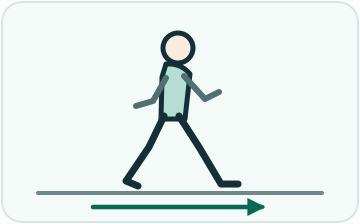

1. Izberite ravno pot. Če so vam predpisali pripomoček za hojo, ga uporabite.
2. Začnite počasi. Hodite tako, da lahko ves čas govorite v celih stavkih.
3. Proti koncu upočasnite. Dolžino hoje povečujte po načrtu svoje ekipe.

**Ponovitve ali čas** – Primer začetnega cilja je skupaj 10–15 minut hoje na dan. Upoštevajte svoj odpustni načrt. · **Vir** – [Ontario, vadba pri srčnem popuščanju](https://www.ontario.ca/files/2023-12/moh-qbp-clinical-handbook-heart-failure-en-2023-12-11.pdf) · [CUH, hoja pri srčni rehabilitaciji](https://www.cuh.nhs.uk/patient-information/cardiac-rehabilitation-walking-programme/)

### Koraki na stolu · `srcno-koraki-sede`

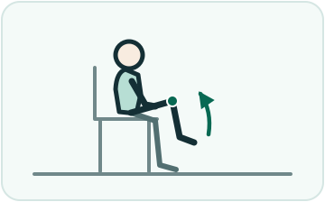

1. Sedite vzravnano na stabilen stol. Stopali položite na tla.
2. Z rokama ob telesu rahlo dvignite eno koleno in stopalo vrnite na tla.
3. Zamenjajte nogo. Nadaljujte počasi in dihajte sproščeno.

**Ponovitve ali čas** – 1 minuta počasnih izmeničnih korakov kot del dogovorjenega ogrevanja. · **Vir** – [Oxford University Hospitals, sedeči program, str. 19](https://www.ouh.nhs.uk/media/ryhji1z0/106200rehab.pdf)

### Izteg kolena na stolu · `srcno-izteg-kolena`

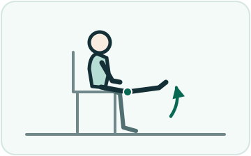

1. Sedite vzravnano, s stopali na tleh. Z rokama se lahko primete za rob stola.
2. Med izdihom počasi iztegnite eno koleno. Prste potegnite proti sebi in zadržite 1 sekundo.
3. Med vdihom stopalo počasi spustite na tla. Ponovite z drugo nogo.

**Ponovitve ali čas** – 6–8 na vsako nogo. Če je tako v načrtu, po odmoru ponovite še en niz. · **Vir** – [American Heart Association, vaje za moč in ravnotežje pri srčnem popuščanju, str. 1](https://www.heart.org/-/media/Files/Health-Topics/Heart-Failure/Strength-and-Balance.pdf)

## `srce-po-infarktu` · Po infarktu ali operaciji srca

Bolničar izbere vaje glede na poseg, čas od odpusta in omejitve gibanja. Vaja za ramena po operaciji velja, če jo je potrdila kirurška ekipa. [ESC, srčna rehabilitacija](https://academic.oup.com/eurheartj/article/47/39/5631/8766284) · [Southampton, gibanje po operaciji prsnice](https://www.uhs.nhs.uk/Media/UHS-website-2019/Patientinformation/Heartandlungs/Post-sternotomy-activity-3135-PIL.pdf)

### Kratek sprehod · `srce-hoja`

1. Izberite ravno pot. Prve sprehode opravite s spremljevalcem, če tako svetuje ekipa.
2. Začnite zelo počasi in hodite v tempu, v katerem se lahko pogovarjate.
3. Pred koncem upočasnite. Najprej podaljšujte čas hoje po načrtu svoje ekipe.

**Ponovitve ali čas** – Za nekatere je primerno začeti s 5–10 minutami hoje. Upoštevajte predpisano dolžino, ogrevanje in ohlajanje. · **Vir** – [CUH, program hoje](https://www.cuh.nhs.uk/patient-information/cardiac-rehabilitation-walking-programme/) · [Royal Brompton, hoja po operaciji srca](https://www.rbht.nhs.uk/sites/nhs/files/Leaflets/After%20your%20heart%20operation%20-%20Royal%20Brompton%20Hospital-%20February%202022_0.pdf)

### Dvigovanje kolen sede · `srce-dvigi-kolen`

1. Sedite vzravnano na stabilen stol. Stopali položite na tla.
2. Počasi dvignite eno pokrčeno koleno, kolikor vam je udobno.
3. Stopalo mirno spustite na tla in zamenjajte nogo.

**Ponovitve ali čas** – 10 dvigov skupaj kot del ogrevanja, če je vaja v vašem načrtu. · **Vir** – [UHCW, ogrevanje v programu srčne rehabilitacije, str. 3](https://www.uhcw.nhs.uk/download/clientfiles/files/Patient%20Information%20Leaflets/Medicine/Cardiology/Cardiac%20Rehabilitation%20Circuit%20Training%20Programme.pdf)

### Dvig in spust ramen · `srce-ramena`

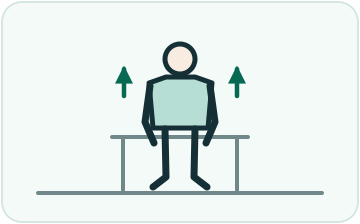

1. Sedite vzravnano. Roki naj sproščeno visita ob telesu.
2. Počasi dvignite rameni proti ušesom.
3. Počasi spustite rameni in ju sprostite.

**Ponovitve ali čas** – 5–10 ponovitev po navodilu ekipe po operaciji prsnice. · **Vir** – [Southampton, vaje za ramena po operaciji prsnice](https://www.uhs.nhs.uk/Media/UHS-website-2019/Patientinformation/Heartandlungs/Post-sternotomy-activity-3135-PIL.pdf)

## `kolk-koleno` · Nov kolk ali koleno

Veljajo omejitve gibanja, obremenjevanja in uporabe pripomočkov iz odpustnice. Pri zamenjavi kolka fizioterapevt določi dovoljeni upogib. Navedene ponovitve so za eno izvedbo. Pogostost potrdi fizioterapevt. [Swansea Bay, kolk](https://sbuhb.nhs.wales/hospitals/a-z-services/elective-orthopaedic-physiotherapy/elective-orthopaedic-folder/recovering-from-a-total-hip-replacement/) · [Swansea Bay, koleno](https://swanseabay.nhs.wales/hospitals/a-z-services/elective-orthopaedic-physiotherapy/elective-orthopaedic-folder/recovering-from-a-total-knee-replacement/)

### Premikanje gležnja leže · `sklep-glezenj`

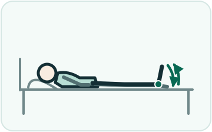

1. Ulezite se na hrbet. Noga naj počiva na postelji.
2. Prste počasi potegnite proti sebi.
3. Prste počasi usmerite stran od sebe. Premik naj ostane udoben.

**Ponovitve ali čas** – 20 premikov gor in dol, če je tako v vašem načrtu. · **Vir** – [Swansea Bay, kolk](https://sbuhb.nhs.wales/hospitals/a-z-services/elective-orthopaedic-physiotherapy/elective-orthopaedic-folder/recovering-from-a-total-hip-replacement/) · [Swansea Bay, koleno](https://swanseabay.nhs.wales/hospitals/a-z-services/elective-orthopaedic-physiotherapy/elective-orthopaedic-folder/recovering-from-a-total-knee-replacement/)

### Napnite stegno · `sklep-napni-stegno`

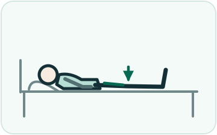

1. Ulezite se na hrbet in iztegnite operirano nogo.
2. Zadnjo stran kolena potisnite proti postelji, da napnete sprednji del stegna.
3. Zadržite 3 sekunde, ves čas dihajte, nato stegno sprostite.

**Ponovitve ali čas** – 10 ponovitev z operirano nogo. · **Vir** – [Swansea Bay, kolk](https://sbuhb.nhs.wales/hospitals/a-z-services/elective-orthopaedic-physiotherapy/elective-orthopaedic-folder/recovering-from-a-total-hip-replacement/) · [Swansea Bay, koleno](https://swanseabay.nhs.wales/hospitals/a-z-services/elective-orthopaedic-physiotherapy/elective-orthopaedic-folder/recovering-from-a-total-knee-replacement/)

### Podrsajte s peto po postelji · `sklep-drsenje-pete`

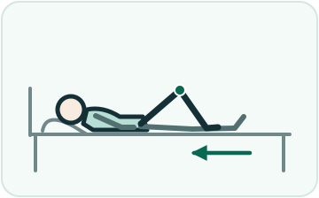

1. Ulezite se na hrbet. Operirana noga naj bo iztegnjena.
2. Peto počasi povlecite proti zadnjici. Naj ostane na postelji.
3. Ustavite se pri upogibu, ki ga je dovolil fizioterapevt, in nogo počasi iztegnite.

**Ponovitve ali čas** – 10 ponovitev z operirano nogo. · **Vir** – [Swansea Bay, kolk](https://sbuhb.nhs.wales/hospitals/a-z-services/elective-orthopaedic-physiotherapy/elective-orthopaedic-folder/recovering-from-a-total-hip-replacement/) · [Swansea Bay, koleno](https://swanseabay.nhs.wales/hospitals/a-z-services/elective-orthopaedic-physiotherapy/elective-orthopaedic-folder/recovering-from-a-total-knee-replacement/)

## `kopb` · KOPB

Po poslabšanju dolžino hoje določi ekipa za pljučno rehabilitacijo. Dihalni vaji sta za učenje tehnike in obvladovanje običajne zadihanosti. Ob nenadni hudi zadihanosti pokličite 112. [GOLD 2027, pljučna rehabilitacija](https://goldcopd.org/2027-gold-report-and-pocket-guide/) · [HSE, obvladovanje zadihanosti](https://www2.hse.ie/conditions/copd/learning-to-control-your-breathing/) · [Klic v sili](https://www.gov.si/teme/klic-v-sili/)

### Počasen izdih skozi priprte ustnice · `kopb-izdih`

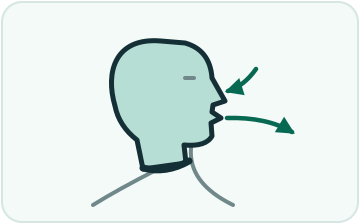

1. Sedite udobno. Sprostite vrat in ramena.
2. Nežno vdihnite skozi nos, če lahko, in štejte do 2.
3. Ustnice rahlo stisnite, kot pri žvižganju in nežno izdihnite, medtem ko štejete do 4.
4. Nadaljujte v mirnem ritmu. Če se vam vrti, prekinite.

**Ponovitve ali čas** – Tehniko vadite štirikrat ali petkrat na dan, če vam je fizioterapevt priporočil to tehniko. · **Vir** – [HSE, dihanje skozi priprte ustnice](https://www2.hse.ie/conditions/copd/learning-to-control-your-breathing/)

### Odmor z oporo na kolenih · `kopb-opora`

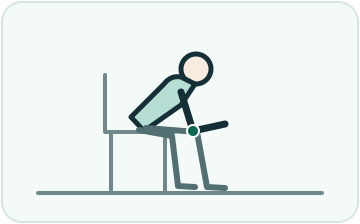

1. Sedite na stabilen stol. Stopali položite plosko na tla.
2. Nagnite se malo naprej in komolca sproščeno naslonite na stegna.
3. Sprostite ramena. Dihajte mirno in se osredotočite na sproščen izdih.

**Ponovitve ali čas** – En odmor po potrebi, dokler se običajna zadihanost ne umiri. · **Vir** – [CUH, položaji za lažje dihanje](https://www.cuh.nhs.uk/patient-information/leaflet-4-positions-to-ease-breathlessness/) · [CUH, umirjanje dihanja](https://www.cuh.nhs.uk/patient-information/breathing-techniques-to-ease-breathlessness/)

### Hoja z odmori · `kopb-hoja`

1. Izberite ravno pot, kjer se lahko varno ustavite.
2. Začnite počasi in dihajte sproščeno.
3. Po potrebi se ustavite in počivajte. Ko se dihanje umiri, nadaljujte po svojem načrtu.

**Ponovitve ali čas** – V programu Kent je krajša možnost 10 minut hoje. Pri odpustu naj ekipa potrdi primeren čas in odmore. · **Vir** – [Kent, program pljučne rehabilitacije doma](https://www.kentcht.nhs.uk/leaflet/home-pulmonary-rehabilitation-programme-2/) · [CUH, tehnike dihanja](https://www.cuh.nhs.uk/patient-information/breathing-techniques-to-ease-breathlessness/)

## `mozganska-kap` · Možganska kap

Fizioterapevt potrdi varno stran, število ponovitev, oporo in potrebno pomoč. Pri vajah na stolu naj bo stol stabilen in brez koles. Ob novih znakih kapi pokličite 112. [NICE NG236, gibanje po kapi](https://www.nice.org.uk/guidance/ng236/chapter/Recommendations#movement) · [UHB, vaje po kapi, str. 2–5](https://www.uhb.nhs.uk/media/zhajlskn/stroke-exercise-booklet_stroke-team_pi.pdf) · [Klic v sili](https://www.gov.si/teme/klic-v-sili/)

### Pokrčite nogo leže · `kap-drsenje-pete`

1. Ulezite se na hrbet in iztegnite nogi.
2. Počasi pokrčite koleno. Peta naj drsi po postelji.
3. Koleno naj ostane v smeri kolka. Nato počasi iztegnite nogo.

**Ponovitve ali čas** – Do 10 ponovitev z nogo, ki jo določi fizioterapevt. · **Vir** – [UHB, vaje po kapi, str. 3](https://www.uhb.nhs.uk/media/zhajlskn/stroke-exercise-booklet_stroke-team_pi.pdf)

### Dvig kolena sede · `kap-dvig-kolena`

1. Sedite vzravnano na stabilen stol. Stopali položite na tla.
2. Počasi dvignite eno koleno in ostanite vzravnani.
3. Stopalo počasi položite nazaj na tla. Zamenjajte nogo, če je tako v načrtu.

**Ponovitve ali čas** – Do 10 ponovitev po načrtu fizioterapevta. · **Vir** – [UHB, vaje po kapi, str. 3–4](https://www.uhb.nhs.uk/media/zhajlskn/stroke-exercise-booklet_stroke-team_pi.pdf)

### Vstajanje s stola · `kap-vstajanje`

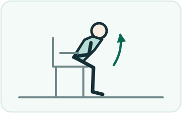

1. Sedite na stabilen stol z naslonjaloma za roke. Stopali položite na tla.
2. Z zgornjim delom telesa se rahlo nagnite naprej.
3. Počasi vstanite z dogovorjeno oporo in pomočjo.
4. Počasi se spustite nazaj na stol.

**Ponovitve ali čas** – Do 10 ponovitev, samo če je fizioterapevt potrdil varno vstajanje doma. · **Vir** – [UHB, vaje po kapi, str. 3–4](https://www.uhb.nhs.uk/media/zhajlskn/stroke-exercise-booklet_stroke-team_pi.pdf) · [NICE NG236, ponavljanje vsakdanjih gibov](https://www.nice.org.uk/guidance/ng236/chapter/Recommendations#movement)

## `rak-sistemsko` · Rak na sistemskem zdravljenju

Onkološka ekipa potrdi primerno obremenitev in prilagoditve glede na zdravljenje in počutje. Pri vročini 38 °C ali več prekinite vadbo in pokličite svoj onkološki oddelek po odpustnih navodilih. [ASCO, dejavnost med zdravljenjem](https://ascopubs.org/doi/10.1200/JCO.22.00687) · [Onkološki inštitut Ljubljana, neželeni učinki sistemskega zdravljenja](https://www.onko-i.si/fileadmin/onko/datoteke/Strokovna_knjiznica/publikacije_za_bolnike/Napotki_za_premagovanje_nezelenih_ucinkov_sistemskega_zdravljenja_raka_2023.pdf)

### Nežen sprehod · `rak-hoja`

1. Izberite kratko, ravno pot doma ali zunaj.
2. Hodite počasi, v tempu, v katerem lahko govorite.
3. Počivajte, ko se utrudite. Sprehod lahko razdelite na krajše dele.

**Ponovitve ali čas** – Primer je 10 minut lahke hoje, skupaj ali v krajših delih glede na počutje in načrt. · **Vir** – [Memorial Sloan Kettering, gibanje in utrujenost](https://www.mskcc.org/cancer-care/patient-education/managing-cancer-related-fatigue-exercise) · [American Cancer Society, gibanje med zdravljenjem](https://www.cancer.org/cancer/supportive-care/nutrition-activity-with-cancer/physical-activity-when-you-have-cancer.html)

### Dvig kolena na stolu · `rak-koleno-sede`

1. Sedite vzravnano na stabilen stol. Primite se za naslonjali za roke.
2. Počasi dvignite eno koleno, kolikor vam je udobno. Ostanite vzravnani.
3. Stopalo počasi spustite. Ponovite še z drugo nogo.

**Ponovitve ali čas** – 5 dvigov na vsako nogo. · **Vir** – [Memorial Sloan Kettering, gibanje in utrujenost](https://www.mskcc.org/cancer-care/patient-education/managing-cancer-related-fatigue-exercise)

### Premikanje stopal sede · `rak-stopala-sede`

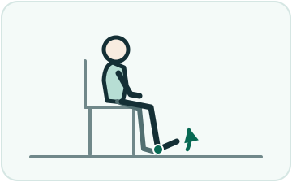

1. Sedite na stabilen stol in položite peti na tla.
2. Prste povlecite proti sebi. Peti naj ostaneta na tleh.
3. Spustite prste proti tlom. Premik ponovite počasi.

**Ponovitve ali čas** – 10 ponovitev. · **Vir** – [Memorial Sloan Kettering, gibanje in utrujenost](https://www.mskcc.org/cancer-care/patient-education/managing-cancer-related-fatigue-exercise)
